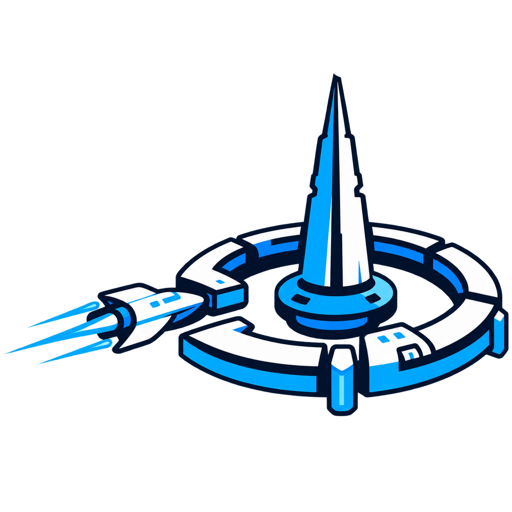

# Dockspire branding

The owner-supplied `Dockspire_Fresh_Brand_Pack` provides the current **Dockspire** artwork. The approved direction is the flat orbital docking station: central blue-and-white spire, segmented docking ring, and spacecraft approaching from the left. The tagline is **DOCK. DEPLOY. MANAGE.**

The [asset status](branding/ASSET_LICENSE_NOTES.md) records the supplied artwork’s provenance and limitations. Runtime images are copied directly from the pack without tracing, recoloring, or modifying the motif.

## Final artwork

| Artwork | Supplied asset | Repository preview | Native dimensions | Use |
| --- | --- | --- | --- | --- |
| Transparent mark | `marks/dockspire-mark-transparent.png` | [View mark](../web/brand/dockspire-icon-256.png) | 1254 × 1254 | Sidebar, sign-in, browser/touch icon and documentation; light or dark surfaces |
| Primary horizontal logo | `logos/dockspire-logo-horizontal-primary.png` | [View horizontal logo](../web/brand/dockspire-horizontal-dark.png) | 2172 × 724 | Administrator setup on a light card; navy lettering needs a light surface |

Both repository assets retain the supplied PNG bytes, transparency and native dimensions. The legacy `icon-256` and `horizontal-dark` filenames are compatibility paths rather than size or background guidance. Render them proportionally at the sizes described below. The mark above keeps documentation readable in light and dark themes; the horizontal logo is linked for use on light surfaces.

## Application use

- Sidebar: supplied transparent mark at 44 px (40 px on narrow screens).
- Sign-in: the transparent mark at 56 px, beside the product name and tagline, directly on the dark card.
- Administrator setup: the exact supplied 2172 × 724 primary horizontal logo on a light setup card, with no separate logo plate or background. Fields, help, errors and keyboard focus use matching light-card colors.
- Sidebar and sign-in use a responsive HTML wordmark: `Dock` is white and `spire` is blue, with the existing system font because the package includes no font files. The wordmark remains visible on narrow screens.
- Browser and touch icon: the same transparent PNG, explicitly referenced as PNG rather than ICO.
- README: transparent mark with a theme-native heading and tagline.

The original 1254 × 1254 `marks/dockspire-mark-transparent.png` is copied without image processing to the compatibility path `web/brand/dockspire-icon-256.png`. Its legacy filename does not describe its native dimensions. Sidebar, sign-in and browser icons use this mark directly without an opaque tile source or high-density tile override. Setup uses the unmodified horizontal primary logo at the compatibility path web/brand/dockspire-horizontal-dark.png; its navy text remains readable on the light card.

Only the exact runtime logo/icon paths, stylesheet, login assets, and minimal health endpoint are public before sign-in. Application pages, scripts, inventory, definitions, and other brand-directory paths retain their existing authentication requirements. Assets are embedded in the Go executable and require no external font/image service or frontend build.

## Navigation icons

Navigation uses static inline outlines from [Lucide 0.468.0](https://github.com/lucide-icons/lucide/tree/0.468.0/icons). The geometry is unchanged; wrappers use 20 px boxes, a 24-unit viewBox, currentColor strokes, and decorative aria-hidden/focusable attributes. Text labels, active states and keyboard focus remain the navigation interface. No icon script, font, package or external request is needed at runtime.

| Section | Lucide icon |
| --- | --- |
| Dashboard | layout-dashboard |
| Stacks | layers |
| Containers | container |
| Images | package |
| Networks | network |
| Volumes | hard-drive |
| Docker | server |

Images represents container image packages, not photographs. The [complete icon notices](../licenses/lucide-LICENSE) retain the pinned release's ISC license and the separately sourced Feather MIT license, including the Feather-derived server icon. These licenses cover the icons, not Dockspire's source or supplied branding.

## Interface palette

| Role | Color |
| --- | --- |
| Brand navy / browser theme | `#0B1F3B` |
| App background | `#0B1422` |
| Sidebar | `#0C1B2C` |
| Panels | `#121F30` |
| Electric blue / primary actions / charts | `#2EA0FF` |
| Primary action hover | `#66BAFF` |
| Active navigation / selected tabs | `#142F4B` |
| Main text | `#EDF5FF` |
| Secondary text | `#A0B1C6` |

These UI choices interpret the suggested palette against the supplied source; they are not claimed to be exact original artwork specifications. Green success/running, amber warning/partial, and red error/unhealthy indicators keep their functional meaning. Keyboard focus uses a visible blue outline. The interface retains its existing dark theme; transparent artwork sits directly on that surface.

## Compatibility

Visible interface copy, errors, startup messages, documentation, and browser download names use Dockspire. Download filenames are now `dockspire-library-<timestamp>.zip` and `dockspire-<stack>-compose.zip`.

Existing deployment and storage contracts keep their legacy identifiers: `stacklane` executable/release paths, `stacklane-preview` Compose project/image names, `STACKLANE_*` environment variables, host-helper service/socket paths, cookie names, `X-Stacklane-CSRF`, archive manifest kind `stacklane-library`, and exported `stacklane-record.json`. This avoids creating a second installation or invalidating saved libraries during a visual rebrand. Existing archives still restore without conversion. A future operational rename needs a separate migration plan. The later source reorganization changed only the Go module to `github.com/Mayo-Nas/dockspire`; that build identifier does not migrate runtime state.

Dockspire currently focuses on Compose stacks. Multi-host management is planned; the branding does not imply that unimplemented features are available.

## Asset limitations

The supplied artwork is raster-based; there is no vector master or bundled font. Earlier tile icons and the legacy ICO remain in the repository for compatibility/history but are not referenced by active application branding. Any future vector redraw should be reviewed against the approved concept. See the asset notes for provenance; no trademark or domain clearance is represented.
